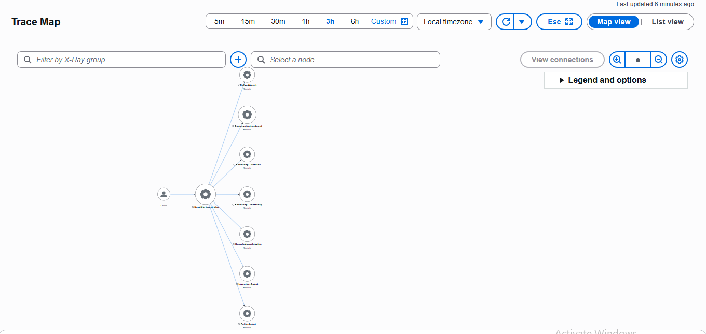
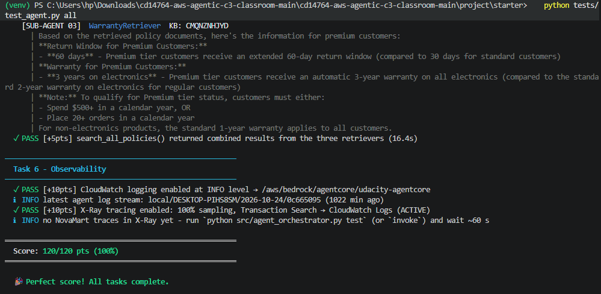

# NovaMart Multi-Agent Customer Support

A production-style, multi-agent customer support system built on **Amazon Bedrock AgentCore** with the **Strands Agents SDK**. An orchestrator routes each request to specialist agents, policy answers come from three Knowledge Bases queried in parallel, and the whole call chain is traced end to end.

Built as the capstone of the Udacity AWS Agentic AI program.

## What it does

A customer message comes in (order status, return or refund request, policy question). The orchestrator decides which specialists to call, shared workflow state tracks what each one found, and a communication agent writes the final customer reply.

## Architecture

```
Client
  └── NovaMart-Orchestrator  (Claude Haiku 4.5, temperature 0.0)
        ├── InventoryAgent       order status, customer tier, order history
        ├── RefundAgent          return eligibility and refund initiation
        ├── PolicyAgent          coordinator for three parallel retrievers
        │     ├── Returns retriever   → Returns Knowledge Base
        │     ├── Shipping retriever  → Shipping Knowledge Base
        │     └── Warranty retriever  → Warranty Knowledge Base
        └── CommunicationAgent   writes the final customer-facing reply
```

### Design decisions

- **The orchestrator only routes.** It never writes the customer response. Every request ends with the communication agent.
- **Shared workflow state.** Each routing tool reads the session's `WorkflowState` before calling a worker and writes results back with versioned updates, so agents build on each other's findings and stale writes are rejected.
- **Parallel multi-agent RAG.** `search_all_policies` runs the three retriever agents concurrently with `ThreadPoolExecutor(max_workers=3)` and `as_completed()`, then combines the results.
- **Model selection by role.** A fast, low-cost model (Claude Haiku 4.5) handles routing. Worker agents use Claude Sonnet 4.5 for higher-quality reasoning. Model IDs come from `config`, never hardcoded.
- **Temperature by role.** Retrievers 0.0 (stable retrieval), orchestrator 0.0 (deterministic routing), Inventory and Refund 0.1, PolicyAgent coordinator 0.2, CommunicationAgent 0.3 (natural replies).
- **Business rules in the refund agent.** Standard customers have a 30-day return window, Premium customers 60 days.

## Safety, memory and observability

| Area | Implementation |
|---|---|
| Guardrail | Bedrock Guardrail with content filters (sexual, violence, hate at high strength; insults, misconduct at medium), PII handling (block card numbers and SSNs; anonymize emails and phone numbers), denied topics (competitor products, pricing negotiation, legal threats) and a managed profanity list. A numbered guardrail version is attached to every agent's model. |
| Memory | AgentCore Memory with a session-summary strategy and 7-day event retention. |
| Logging | CloudWatch logging at INFO level for the deployed agent. |
| Tracing | X-Ray tracing at 100% sampling, giving a full service map of the agent call chain. |
| Deployment | AgentCore Runtime with public networking over HTTP, deployed through the AgentCore CLI with Knowledge Base IDs and guardrail settings passed as environment variables. |

## Distributed tracing

The X-Ray service map shows the orchestrator calling every worker, including the PolicyAgent and the three Knowledge Base agents.



## Testing

The project includes a graded test suite covering each task: worker agents, parallel retrieval, orchestration, guardrail and runtime deployment, memory, and observability.

```bash
python tests/test_agent.py all
```

Result: **120/120**



## Repository layout

```
src/
  agent_orchestrator.py   agents, orchestration, guardrail, deployment, memory, observability
  agent_utils.py          shared helpers
  bedrock_kb_retrieval.py Knowledge Base retrieval
  agentcore_cli.py        AgentCore CLI wrapper
  agent_observability.py  observability helpers
tests/
  test_agent.py           graded test suite
infrastructure/
  starter_stack.yaml      foundation stack (CloudFormation)
  seed_data.py            sample data
  cleanup.py              resource cleanup
config.py                 model IDs and settings
.env.example              environment variables to fill in
```

## Running it yourself

You need an AWS account with Amazon Bedrock model access enabled, and the foundation stack deployed from `infrastructure/starter_stack.yaml`.

1. Create a virtual environment and install dependencies:
   ```bash
   python -m venv venv
   source venv/bin/activate   # Windows: venv\Scripts\activate
   pip install -r requirements.txt
   ```
2. Copy `.env.example` to `.env` and fill in your values (region, project name, Knowledge Base IDs, runtime ARN, guardrail ID and version). Never commit `.env`.
3. Create the three Bedrock Knowledge Bases (returns, shipping, warranty) on S3 Vectors with the Titan Text Embeddings V2 model, and sync their data sources.
4. Run the scenarios and the tests:
   ```bash
   python src/agent_orchestrator.py test
   python tests/test_agent.py all
   ```

## What I would build next

- Adversarial guardrail testing (prompt injection, competitor mentions, legal threats) with documented blocked responses.
- A CloudWatch dashboard for invocation count, per-agent latency and guardrail trigger frequency.
- Persistent session storage in DynamoDB alongside AgentCore Memory.
- A Cognito-authenticated web front end connected to the AgentCore Runtime endpoint.

## Tech stack

Amazon Bedrock AgentCore, Strands Agents SDK, Amazon Bedrock (Claude Sonnet 4.5 and Haiku 4.5, Titan Text Embeddings V2), Bedrock Knowledge Bases on S3 Vectors, Bedrock Guardrails, Amazon DynamoDB, Amazon CloudWatch, AWS X-Ray, Python.

## Author

**Miracle Maduabuchi**, Agentic AI Product Leader. AWS Certified AI Practitioner.
